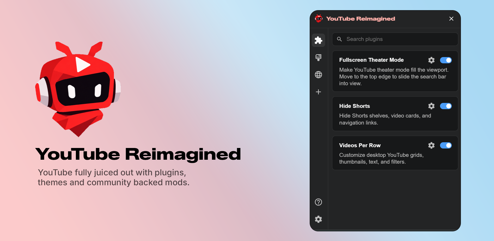
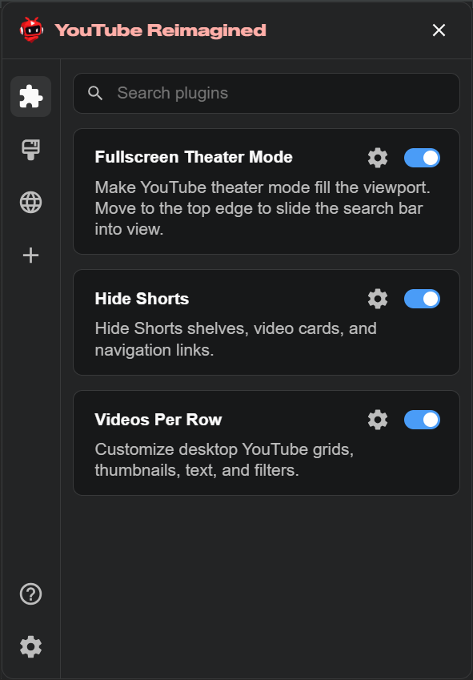
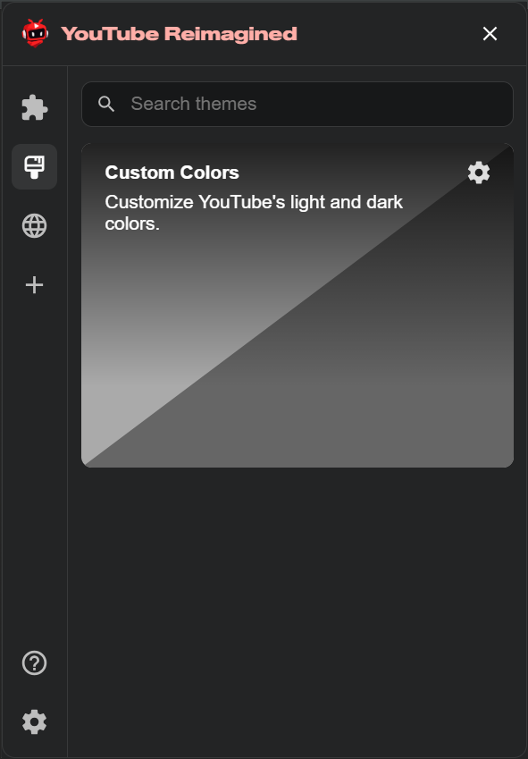
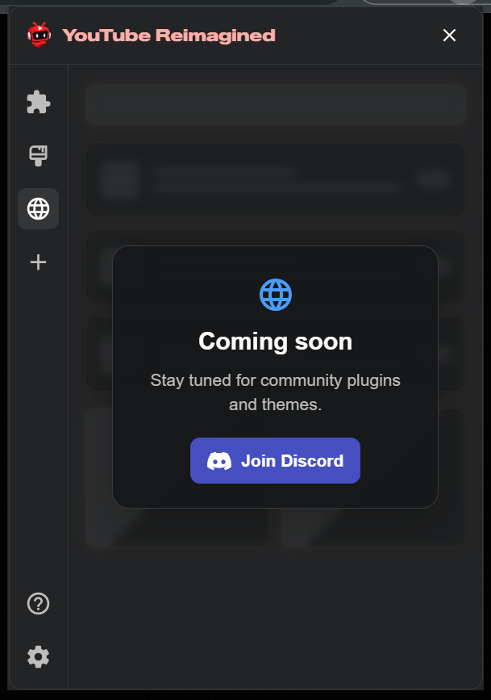
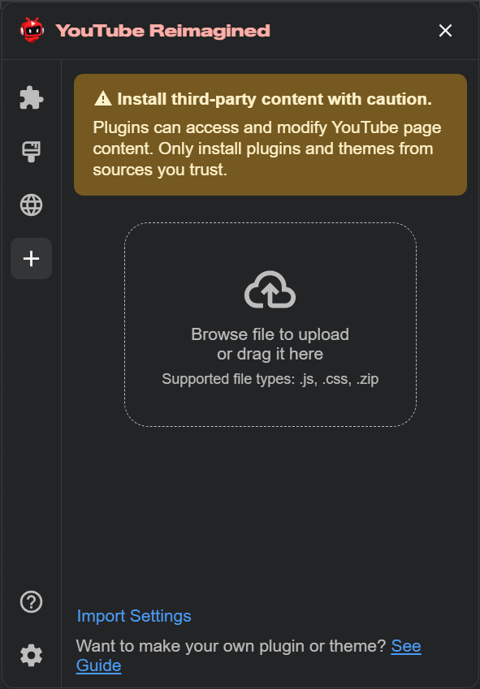
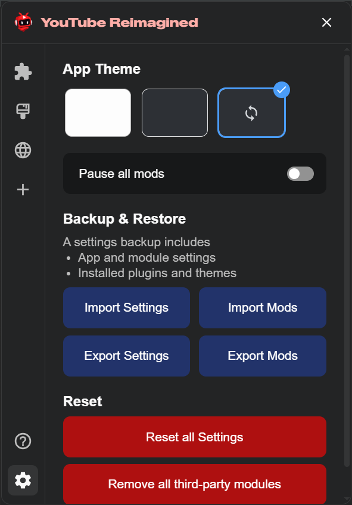
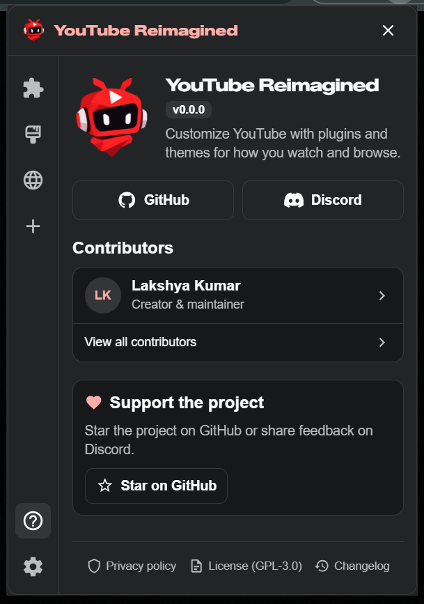

<p align="center">
  
</p>

<h1 align="center">YouTube Reimagined</h1>

<p align="center">
  Browser extension to customize YouTube website with plugins and themes, with community-first support and huge library.
</p>

<p align="center">
  <a href="https://github.com/Antinity/YouTube-Reimagined/releases/latest"></a>
  
  
  
  <a href="LICENSE"></a>
</p>

<p align="center">
  <a href="#get-started">Get started</a> ·
  <a href="#features">Features</a> ·
  <a href="#screenshots">Screenshots</a> ·
  <a href="#documentation">Documentation</a> ·
  <a href="#contributors">Contributors</a>
</p>

<p align="center">
  
</p>

## Features

### Bundled plugins

| Plugin | What you can customize |
| --- | --- |
| **Comment Plus** | Search loaded desktop comment threads and optionally sort by newest when a video opens. |
| **Custom Progress Bar** | Pick solid colors or a gradient, give the timeline or playhead a custom image, or use the Nyan Cat preset. |
| **Default Video Quality** | Set separate resolutions for videos, playlists, pop-up players, and embeds. Choose a fullscreen override and whether to restore the default when exiting. |
| **Default Volume** | Set the starting volume for each new video. |
| **Focus Mode** | Hide distractions and add individual watch-page buttons for the sidebar, comments, live chat, playlist, and description. Optionally open Subscriptions instead of Home. |
| **Fullscreen Theater Mode** | Fill the viewport in desktop YouTube’s theater mode. Optionally open each video in theater mode, adjust player height and spacing above the video details, and reveal the search bar by hovering at the top edge or tabbing into the header. |
| **Hide Shorts** | Hide Shorts shelves, cards, and navigation links. Choose where to hide them across Home, the sidebar, search, subscriptions, channels, hashtag pages, and the watch page. |
| **Keyboard Shortcuts** | Press Ctrl+K to focus YouTube search. |
| **Old Player Controls** | Restore a classic toolbar and icons. Optionally change the recommendation sidebar, navigation order, and comment threads. |
| **Open Shorts as Videos** | Open Shorts in the standard watch page. |
| **Scroll to Change Speed** | Hold Ctrl by default and scroll over the player. Choose the modifier and adjustment size. |
| **Scroll to Change Volume** | Scroll over selected player quadrants or hold a configurable modifier. The top quadrants are active by default. |
| **Videos Per Row** | Set separate desktop column counts for videos, Shorts, and Community posts. Adjust spacing, typography, search and watch layouts, and visibility filters. |
| **Watched Overlay** | Mark thumbnails that have YouTube watch progress. |
| **YouTube Font** | Choose a preset such as Inter or provide an HTTPS font file URL. |

### Bundled theme

**Custom Colors** lets you set separate light and dark palettes for YouTube. Each palette has background, foreground, accent, blue, green, and yellow controls. Search-box animations are optional.

### Manage plugins, themes, and settings

- **Control mods from the popup.** Search installed modules, enable plugins independently, and select one YouTube theme at a time. Changes usually reach open YouTube tabs immediately. Switching themes preserves each theme’s settings.
- **Customize the popup.** Choose Light, Dark, or System for the extension interface. Use **Pause all mods** to suspend plugins and themes while retaining your selections and settings.
- **Import your own mods.** Open **Add** to select or drop a JavaScript plugin, a supported CSS theme, a theme ZIP, or a ZIP containing multiple mods. Review metadata, validation results, and any replacement before installing. Imported plugins start disabled.
- **Back up or transfer your setup.** **Export Settings** saves a JSON backup with preferences, module settings, and installed modules. Preview a backup before restoring it in **Merge** or **Replace** mode. **Export Mods** creates a ZIP of imported plugins and themes that you can transfer with **Import Mods**.
- **Reset or remove what you choose.** Restore a single module’s defaults, remove individual imports, reset preferences while keeping installed mods, remove all imported mods, or reset all extension data. Settings and installed modules are stored in your browser.

## Screenshots

<p align="center">
  <a href="assets/screenshots/plugins.png"></a>
  <a href="assets/screenshots/themes.png"></a>
  <a href="assets/screenshots/browse.png"></a>
</p>

<p align="center">
  <a href="assets/screenshots/add.png"></a>
  <a href="assets/screenshots/settings.png"></a>
  <a href="assets/screenshots/about.png"></a>
</p>

The About screenshot was captured before the 1.0.0 version bump.

## Get started

Download a ZIP from [GitHub Releases](https://github.com/Antinity/YouTube-Reimagined/releases/latest). Installation is manual.

### Chrome

1. Download and extract `youtube-reimagined-1.0.0-chrome.zip` to a permanent folder.
2. Open `chrome://extensions` and turn on **Developer mode**.
3. Click **Load unpacked** and select the extracted folder containing `manifest.json`.
4. Open YouTube and select **YouTube Reimagined** in the browser’s Extensions menu. Refresh any YouTube tabs that were already open.

The extension targets `www.youtube.com` and `m.youtube.com`. Playback controls also support YouTube embeds, including `www.youtube-nocookie.com`. Fullscreen Theater Mode, Videos Per Row, Old Player Controls, and Comment Plus apply to desktop YouTube.

### Firefox

1. Download and extract `youtube-reimagined-1.0.0-firefox.zip`.
2. Open `about:debugging#/runtime/this-firefox`, click **Load Temporary Add-on**, and select the extracted `manifest.json`.
3. Firefox removes temporary add-ons when it closes. Repeat the installation after restarting Firefox.

Firefox supports bundled plugins and CSS themes. Running imported JavaScript plugins requires Chromium.

### Build from source

Install Node.js 22.12 or later with npm, then run these commands from the repository root.

```sh
cd extension
npm ci
npm run build
```

Load the resulting `extension/.output/chrome-mv3` folder using the Chrome instructions above. For Firefox, run `npm run build:firefox` and select `extension/.output/firefox-mv2/manifest.json`.

### Imported JavaScript plugins

Running imported plugins requires Chromium 135 or later. On Chromium 138 or later, enable **Allow User Scripts** in the extension’s details. On Chromium 135–137, enable **Developer mode** on the Extensions page. Only enable plugins from sources you trust. See the [user guide](docs/user-guide.md) for details.

## Documentation

| Guide | Covers |
| --- | --- |
| [User guide](docs/user-guide.md) | Managing mods, backups, and resets |
| [Plugin development](docs/plugin-development.md) | Authoring JavaScript plugins and using lifecycle hooks |
| [Theme development](docs/theme-development.md) | Authoring CSS themes, metadata, and previews |
| [Module settings reference](docs/module-settings.md) | Settings that plugins and themes can expose |
| [Development workflow](docs/development.md) | Running WXT, building for each browser, and testing changes |
| [Privacy policy](docs/privacy-policy.md) | Local storage, browser permissions, and deleting extension data |

## Contributors

Created and maintained by [Lakshya Kumar (Antinity)](https://github.com/Antinity).

<a href="https://github.com/Antinity/YouTube-Reimagined/graphs/contributors">
  
</a>

To work on the extension locally, follow the [development workflow](docs/development.md). Bug reports, feature ideas, and pull requests are welcome via [GitHub Issues](https://github.com/Antinity/youtube-reimagined/issues) and [Pull Requests](https://github.com/Antinity/youtube-reimagined/pulls).

## License

YouTube Reimagined is licensed under the [GNU General Public License v3.0](LICENSE).
